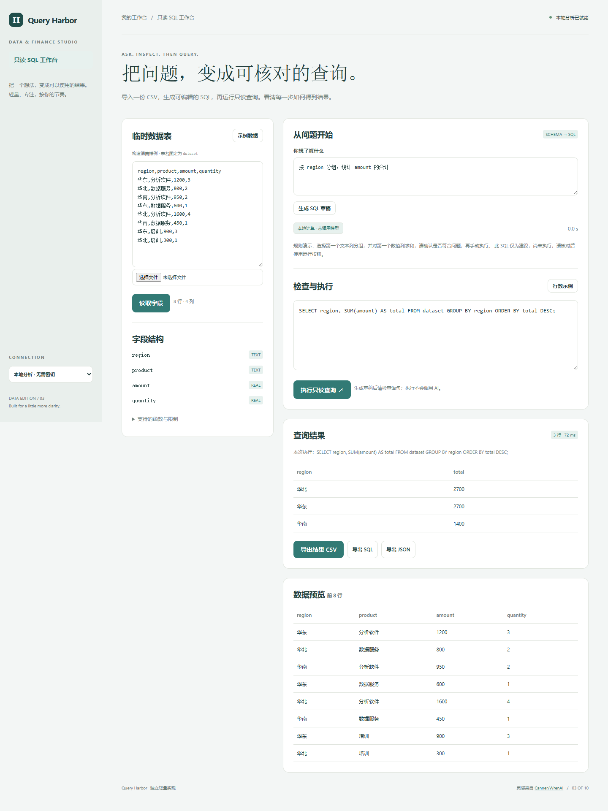

# Query Harbor

导入一份 CSV，生成可编辑的 SQL，再运行只读查询。看清每一步如何得到结果。

- CSV 转为临时 SQLite 表，展示字段与类型
- 自然语言辅助生成 SQL，仅发送字段结构
- 独立进程执行受限 SELECT，结果最多 200 行
- 支持手动编辑、CSV 结果与 SQL 文件导出



## 快速开始

需要 Node.js 24.15 或更新版本；无第三方运行依赖，无需 npm install。

```sh
git clone https://github.com/Yiwen-Yang-BA/chatgpt-query-harbor.git
cd chatgpt-query-harbor
npm start
```

打开 http://127.0.0.1:3203 。默认进入**本地分析模式**，不调用 API；统计值由本地代码计算。示例数据为人工构造，界面明确标注。

### 接入真实模型

复制 `.env.example` 为 `.env`，填写 `OPENAI_API_KEY`，按账号权限设置 `OPENAI_MODEL`，然后重启服务并切换界面中的「AI 生成 SQL」。`OPENAI_BASE_URL` 必须支持 OpenAI Responses API；仅兼容 Chat Completions 的服务不适用。密钥只在服务端读取，不写入前端或仓库。

```sh
# Docker（可选；必须显式传入配置）
docker build -t chatgpt-query-harbor .
docker run --rm -p 127.0.0.1:3203:3203 --env-file .env chatgpt-query-harbor
```

## 使用方法

1. 导入 CSV 并读取字段，临时表名称固定为 dataset。
2. 输入问题后生成 SQL，或直接手动填写 SELECT 语句。
3. 检查语句，点击执行只读查询。生成 SQL 不会自动执行。
4. 查看结果与截断提示，导出当前结果或已执行的 SQL。

## 计算口径

单表名称为 dataset，空单元格转 NULL。全为有效数字且不含前导零编号的列推断为 REAL，其余为 TEXT。SQLite 列名不区分大小写，因此同名大小写变体会被拒绝。只支持单条 SELECT，禁止写入、系统表、外部文件、扩展与递归；支持常用聚合和有限函数。每次查询在独立子进程内执行，2 秒超时，上限 200 行；这不是数据库管理器。

## 验证

```sh
npm run check
npm test
```

测试覆盖业务规则以及本地 HTTP 服务、模拟模型接口、输入校验和错误处理。真实付费模型调用需要用户配置有效密钥，未将本地分析测试作为真实模型质量验证。GitHub Actions 在每次推送时运行检查。

## 参考与复刻范围

灵感来自 [Canner/WrenAI](https://github.com/Canner/WrenAI)（Apache-2.0 (core/sdk/skills/examples/root); CC-BY-4.0 (docs)）。查询快照：2026-10-04；17,799 stars；最近推送 2026-10-02。这是当前星标量与更新状态，**不是近一个月新增星标排名**。

本仓库是对其核心交互和用途的独立轻量实现，未复制上游源码、商标或静态资源，不声称实现上游的全部功能，也不属于上游官方产品。

独立复刻自然语言问题、可检查 SQL、只读查询结果和解释的流程。使用内置示例或用户导入的临时数据表；只允许经限制的 SELECT 查询，设置行数与运行上限。不连接生产数据库、不执行写入或任意脚本，不复刻分布式查询引擎和完整语义治理平台。

## 模型接收的数据

生成 SQL 时仅发送表名、字段名、推断类型和用户问题，不发送原始单元格或查询结果。读取字段和执行查询始终在本机完成，不调用模型。

## 数据与部署边界

CSV 只用于单次请求内的临时内存表，不落数据库文件。结果与查询只保留当前页面。 本地分析数据不离开本机；AI 模式仅发送本项目 README 说明的字段结构和问题到所配置的模型服务。

默认只监听 127.0.0.1，适用于单人本地使用；没有多用户登录或持久数据库。如需公网部署，请先增加身份验证、配额和 HTTPS。服务限制请求大小、并发和超时，禁止从静态目录读取密钥文件。

接口实现依据 [OpenAI 官方文本生成文档](https://developers.openai.com/api/docs/guides/text)。

## License

MIT — independent implementation.

SQLite 权限与运行上限依据 [Node.js 官方 SQLite 文档](https://nodejs.org/download/release/v24.19.0/docs/api/sqlite.html)。
